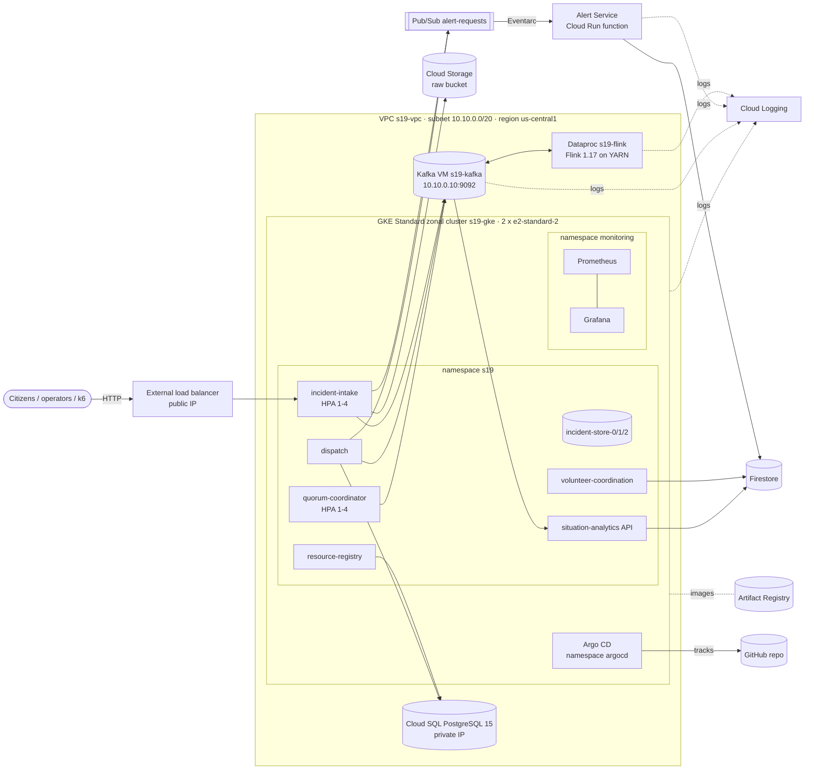
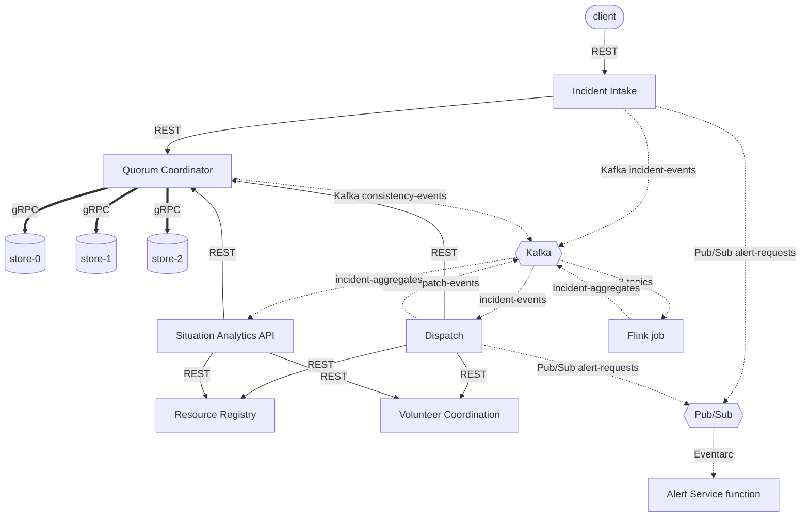

# S19 Disaster Management — Design Document

CS/SS G527 Cloud Computing · Scenario **S19 Disaster Management** · Concept **Leaderless replication (Dynamo-style storage)** · Cloud **Google Cloud Platform (GCP)**

---

## 1. System overview

During a disaster, citizens and field officers report incidents: floods, fires, cyclones, earthquakes. Emergency operators must store every report reliably even while parts of the infrastructure are failing. They also need to send vehicles, supplies, response teams and volunteers, notify people, and see a live picture of what is happening in each region.

The system has **eight microservices**:

| # | Service | Runs on | Responsibility | Data |
|---|---|---|---|---|
| 1 | **Incident Intake** | GKE Deployment + **HPA**, **public URL** | Validates incident reports; stores them through the quorum layer; publishes events to Kafka; sends alert requests for CRITICAL incidents; archives raw reports and attachments | Cloud Storage |
| 2 | **Resource Registry** | GKE Deployment | Vehicles, supply kits and response teams; atomic reservation and release | Cloud SQL (PostgreSQL) |
| 3 | **Replicated Incident Store** | GKE StatefulSet, 3 pods, 3 disks | Three independent replicas storing every version of an incident with its vector clock | One persistent disk per replica |
| 4 | **Quorum Coordinator** | GKE Deployment + **HPA**, stateless | Quorum reads/writes (N=3, W=2, R=2), conflict detection and merge, read repair, anti-entropy, failure injection | — |
| 5 | **Dispatch** | GKE Deployment | Assigns resources and volunteers to incidents, manually (REST) or automatically for CRITICAL incidents (Kafka) | Cloud SQL |
| 6 | **Volunteer Coordination** | GKE Deployment | Volunteer registry, availability, transactional assignment | Firestore |
| 7 | **Alert Service** | **Cloud Run function (serverless)** | Asynchronous: Pub/Sub message → recipients → notifications → delivery record | Firestore |
| 8 | **Situation Analytics** | **Apache Flink on Dataproc** + query API on GKE | 1-minute per-region windows over incident, dispatch and consistency events; surge detection; API that serves the results | Kafka → Firestore |

---

## 2. Cloud deployment architecture

**How it is built and deployed:**
- **Terraform** (`infra/cloud`) creates every cloud resource:
  - VPC, subnet and firewall rules, plus the private IP range for Cloud SQL;
  - the GKE cluster and node pool;
  - the Kafka VM;
  - Artifact Registry, both buckets, Cloud SQL, Firestore and its index, and the Pub/Sub topic;
  - the Cloud Run function with its Eventarc trigger;
  - the Dataproc cluster;
  - all service accounts and IAM roles.
- **Terraform** (`infra/platform`) installs Argo CD and creates the cluster configuration: namespace, ConfigMap and Secrets.
- **Argo CD** deploys **every Kubernetes workload** from the GitHub repo (`argocd/apps/`, `k8s/`): the 7 containerised services, both HPAs, Prometheus/Grafana and the dashboard. Nobody runs `kubectl apply`.
- **`scripts/release.sh`** builds images, pushes them to Artifact Registry and commits the new image tag to Git. Argo CD then rolls out the change.

---

## 3. Microservice architecture and interconnection

### 3.1 Communication matrix

| From → To | Mechanism | Endpoint / topic | Purpose |
|---|---|---|---|
| Client → Incident Intake | **REST** (public) | `POST/GET/PATCH /api/incidents` | Report and read incidents |
| Intake, Dispatch → Quorum Coordinator | **REST** | `PUT/GET /api/quorum/kv/{id}` | Quorum write / read with vector-clock context |
| Dispatch → Resource Registry | **REST** | `POST /api/resources/reserve`, `/release` | Atomic reservation |
| Dispatch → Volunteer Coordination | **REST** | `POST /api/volunteers/assign`, `/release` | Transactional assignment |
| Analytics → Coordinator / Registry / Volunteer | **REST** | `/stats` endpoints | Situation summary |
| Quorum Coordinator → 3 replicas | **gRPC** (`proto/incident_store.proto`) | `Put, Get, Scan, GetBucketHashes, GetBucketDigests, Ping, SetFault` | Leaderless replication |
| Intake → Kafka | **Message queue** | `incident-events` | New/updated incidents |
| Kafka → Dispatch | **Message queue** | `incident-events` (group `dispatch-auto`) | Auto-dispatch of CRITICAL incidents |
| Dispatch → Kafka | **Message queue** | `dispatch-events` | Resource demand |
| Coordinator → Kafka | **Message queue** | `consistency-events` | Conflicts, read repairs, quorum failures |
| Flink ↔ Kafka | **Message queue** | reads 3 topics, writes `incident-aggregates` | Windowed analytics |
| Kafka → Analytics API | **Message queue** | `incident-aggregates` | Store results in Firestore |
| Intake, Dispatch → Alert Service | **Message queue (Pub/Sub)** + Eventarc | `alert-requests` | Asynchronous notifications |

---

## 4. Distributed-systems concept: leaderless (Dynamo-style) replication

**Why it fits disaster management:** incident reports must be accepted even while servers, disks or network paths are failing. A leader-based database stops accepting writes while it elects a new leader. A leaderless store accepts a write as soon as **W** replicas confirm it, and repairs replicas that fell behind afterwards.

**Design** (`services/quorum-coordinator`, `services/incident-store`, `services/common/s19common/vclock.py`):
- **N = 3** independent replicas, each with its own persistent disk. Replicas never talk to each other.
- **W = 2, R = 2, so R + W > N**: every read overlaps every write in at least one replica, so a successful read sees the latest successful write. W and R can be changed per request (`?w=1`, `?r=3`) to *show* the trade-off.
- **Stateless coordinator**: any of its HPA-scaled pods can serve any request.
- **Vector clocks** record which writer has seen which update. Clients send back the `context` they read.
- **Conflicts:** concurrent versions (neither clock contains the other) are kept as **siblings**. On read they are merged with safe domain rules: most advanced status, highest severity, union of notes and assignments. The merged version is written back.
- **Replica failure:** writes go to all 3 in parallel and return after 2 acknowledgements; a slow or failed replica doesn't block them.
- **Read repair:** after a read, replicas holding an older version are updated in the background.
- **Anti-entropy:** every 30 s the coordinator compares hashes of 256 key buckets per replica and repairs only the keys that differ. A replica that was down catches up without manual work.
- **Failure injection** (`POST /api/quorum/replicas/{id}/fault`, protected by an admin token): `down`, `slow`, `drop_writes`, `none`. Real crashes are shown by deleting a replica pod.
- **Verification:**
  - `tests/test_dynamo.py`: 8 tests with real gRPC replicas;
  - `scripts/consistency_test.py`: 14 checks against the deployed system;
  - the Phase 2 scenarios A–E.

---

## 5. Storage products and their purpose

| Product | Data | Why this product |
|---|---|---|
| **Cloud Storage** | Raw incident reports as NDJSON batches (`raw/incidents/…`), uploaded attachments | Cheap append-only archive for files and raw data; batching keeps write operations low |
| **Cloud SQL (PostgreSQL 15)** | `resources`, `resource_reservations`, `dispatch_assignments` | Relational integrity (foreign keys, CHECK rules) and transactions. `SELECT … FOR UPDATE SKIP LOCKED` guarantees two dispatchers never reserve the same vehicle; a version column gives optimistic locking |
| **Firestore** | `volunteers`, `volunteer_assignments`, `alerts`, `analytics_windows` | Semi-structured, frequently changing documents (availability, delivery reports, window results); serverless; transactional assignment |

---

## 6. Stream processing (Flink)

The job lives in `flink/situation-analytics-flink` and runs on a single-node Dataproc cluster:
1. A **KafkaSource** reads `incident-events`, `dispatch-events` and `consistency-events`.
2. JSON parsing (with custom metrics), then event-time watermarks (10 s out-of-orderness).
3. `keyBy(region)`, then a **1-minute tumbling event-time window**. An incremental aggregate keeps counts and a **set of unique reporters** in Flink-managed window state.
4. `keyBy(region)`, then a **surge detector** that keeps a moving baseline in `ValueState` **across windows**.
5. Results are serialised to JSON and written by a **KafkaSink** to `incident-aggregates`.
6. Checkpoints run every 30 s (exactly-once state).

---

## 7. Observability

- **Metrics:** every service exposes `/metrics`:
  - `http_requests_total` and `http_request_duration_seconds`;
  - quorum and replica counters.

  kube-prometheus-stack (Prometheus, Grafana, kube-state-metrics, node-exporter) is deployed by Argo CD and scrapes the services through a ServiceMonitor.
- **Dashboard "S19 Disaster Management":**
  - RPS, 5xx error rate and p95 latency per service;
  - HPA replicas, pod CPU, ready nodes, not-ready pods and restarts;
  - quorum results, read repairs, conflicts, replicas up.
- **Centralised logging (Cloud Logging):**
  - all GKE containers: the services write one JSON line per log entry;
  - the Alert function;
  - the Dataproc Flink job (driver and YARN container logs);
  - the Kafka VM (Docker `gcplogs` driver).

---

## 8. Rationale behind the design choices

| Decision | Alternatives | Reason |
|---|---|---|
| GKE **Standard, zonal, 2 fixed e2-standard-2 nodes** | Autopilot, regional cluster, node autoscaling | Management fee covered by the GKE free-tier credit; fixed size keeps CPU usage within the free-trial limit; HPA still scales pods inside the nodes |
| **Kafka on one VM** with a fixed internal IP | Kafka on GKE, Managed Service for Apache Kafka | The assignment allows (not requires) managed Kafka. A VM is the simplest broker reachable from both GKE pods and Dataproc, and it doesn't depend on Kubernetes |
| **Dataproc single node**, created only when needed, auto-deleted after 2 h idle | Larger Dataproc, Flink on GKE | Meets "Flink on a managed cluster" at minimum cost |
| **Cloud SQL db-f1-micro, private IP, no backups**, stoppable | Larger tiers, public IP + proxy | Cheapest tier; private IP needs no proxy and is not reachable from the internet |
| **Alert Service as a Cloud Run function** with a Pub/Sub trigger | Container on GKE | Truly asynchronous and bursty; scales to zero |
| **LoadBalancer Service** for the public URL | GKE Ingress | Ready in about a minute; one public service is all that's required |
| Pods use the **node service account** | Workload Identity per service | Simpler for a course project; production would use Workload Identity |
| **Argo CD** app-of-apps, installed by Terraform | Flux | Clear UI for demonstrating GitOps |
| **Self-hosted Prometheus/Grafana**, Google Managed Prometheus disabled | Managed Prometheus | Managed Prometheus bills per sample; self-hosted runs on the existing nodes |
| **Cloud Logging** | EFK, Loki | Built in for GKE, Dataproc, functions and VMs; free monthly allotment |
| **Google Cloud Shell** as the only workstation | Local tools on Windows | Nothing to install; same environment for every member |

## 9. Cost (approximate, us-central1)

| Mode | Cost per hour |
|---|---|
| Running (GKE 2 nodes, Kafka VM, Cloud SQL, load balancer, disks) | about $0.21 |
| + Dataproc (only during Flink work and the demo) | + about $0.09 |
| Paused (0 nodes, Cloud SQL and Kafka VM stopped) | about $0.04 |

Cloud Storage, Firestore, Pub/Sub, Cloud Run functions and Cloud Logging stay within their free monthly quotas at this scale. Everything is paid from the $300 free-trial credit.
